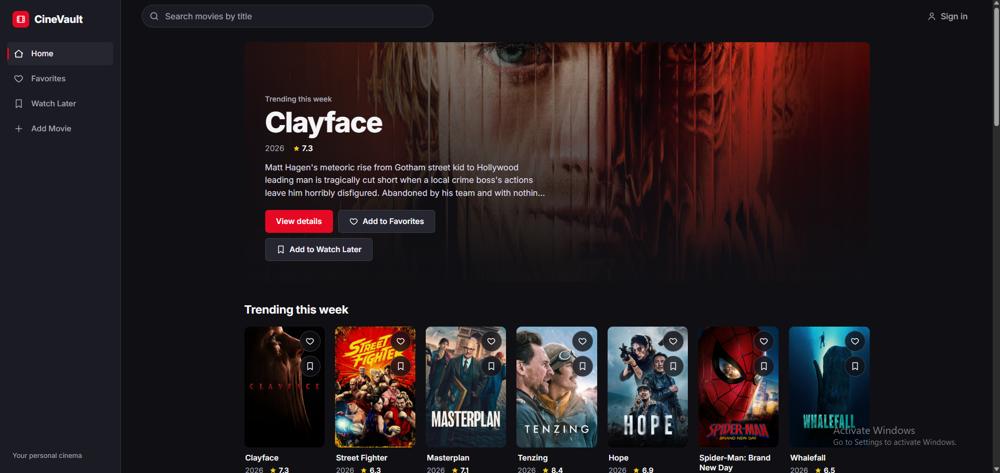
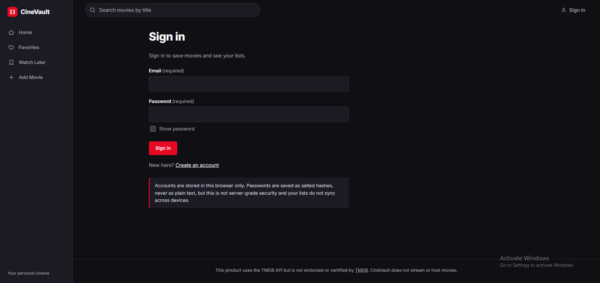
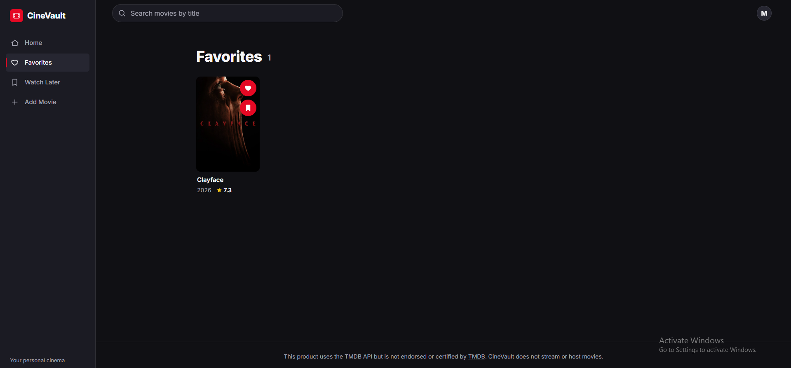
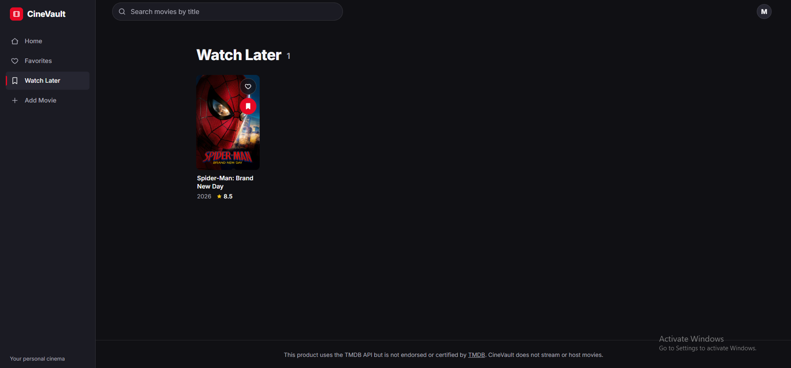

# 🎬 CineVault — Your Personal Cinema

A dark, cinematic movie library built with **React + Vite**. Discover films from the
[TMDb](https://www.themoviedb.org/) catalogue, search by title, view movie details, and keep your own
**Favorites** and **Watch Later** lists under your own account. You can also add custom movies that
aren't in TMDb.

> CineVault does not stream or host movies. Movie data and artwork come from TMDb.

---

## 📸 Output Screenshots

### 1. Home Page
Hero banner, search bar and discovery shelves (Trending, Popular, Top rated, Now playing).



### 2. Movie Details Page
Backdrop, poster, genres, runtime, rating, overview, cast and trailer link.



### 3. Favorites Page
Movies you have saved with the heart button.



### 4. Sign In Page
Email and password login.



---

## ✨ Features

- Home with hero, **Trending**, **Popular**, **Top rated** and **Now playing** shelves
- Title search with debounce, clear button, no-results state and "Load more"
- Movie details: backdrop, poster, genres, runtime, rating, overview, cast, YouTube trailer link
- Email + password **sign in, register and sign out** (salted password hashes, 7-day session, lockout after 5 wrong attempts)
- **Favorites** and **Watch Later**, saved separately for each account
- **Add Movie** form with inline validation for custom entries
- Loading skeletons, error messages with retry, missing-poster placeholders
- Responsive layout: sidebar on desktop, bottom navigation on mobile
- Keyboard focus styles, skip link, labelled controls, reduced-motion support

## 🛠️ Tech Stack

- React 18
- Vite 5
- React Router 6
- TMDb API
- Browser `localStorage` and Web Crypto (for accounts and lists)

---

## 📁 Project Structure

```
cinevault/
├── node_modules/        # installed packages (not uploaded to GitHub)
├── public/              # static files
├── src/
│   ├── api/             # tmdbClient.js, movies.js
│   ├── components/      # AppHeader, Navigation, MovieCard, MovieGrid, SearchBar,
│   │                    # Hero, Poster, States, Toast, RequireAuth, ...
│   ├── hooks/           # useAsync.js
│   ├── pages/           # Home, MovieDetails, Favorites, WatchLater, AddMovie,
│   │                    # Login (also register), Profile
│   ├── state/           # MovieLibraryContext.jsx
│   ├── styles/          # tokens.css, global.css
│   ├── utils/           # storage.js, auth.js, formatters.js
│   ├── App.jsx
│   └── main.jsx
├── .env.example         # example environment file
├── .env.local           # your private API key (not uploaded to GitHub)
├── .gitignore
├── image1.png           # screenshot - Home page
├── image2.png           # screenshot - Movie details page
├── image3.png           # screenshot - Favorites page
├── image4.png           # screenshot - Sign in page
├── index.html
├── package-lock.json
├── package.json
├── README.md
└── vite.config.js
```

---

## 🚀 Getting Started

Requires **Node.js 18 or newer**.

**1. Clone the repository**

```bash
git clone <your-repository-url>
cd cinevault
```

**2. Install dependencies**

```bash
npm install
```

**3. Add your TMDb API key**

Create a TMDb account at <https://www.themoviedb.org/signup> and request API access at
<https://www.themoviedb.org/settings/api>.

Create a file named `.env.local` in the project root (next to `package.json`) with one line:

```
VITE_TMDB_API_KEY=your_key_here
```

If you use the long "API Read Access Token" instead, use this line:

```
VITE_TMDB_READ_ACCESS_TOKEN=your_token_here
```

> `.env.local` is listed in `.gitignore`, so your key is never uploaded. Never commit it.

**4. Start the app**

```bash
npm run dev
```

Open the link shown in the terminal, usually <http://localhost:5173>.

## 📜 Scripts

| Command           | What it does                  |
| ----------------- | ----------------------------- |
| `npm run dev`     | Start the development server  |
| `npm run build`   | Create a production build     |
| `npm run preview` | Preview the production build  |

---

## 🔐 How Login Works

- Browsing and search work without signing in.
- Saving a movie, or opening Favorites, Watch Later or Add Movie, asks you to sign in first.
- Create an account at `/register`, or sign in at `/login`. Sign out from the Profile page.

**Limits:** accounts and lists are stored in your browser's `localStorage`. They stay on that
browser and device and do not sync. Passwords are saved only as salted PBKDF2-SHA-256 hashes, never as
plain text, but this is not server-grade security. Real multi-user accounts need a backend with
authentication and a database.

## ⚠️ API Key Note

Any `VITE_` variable is bundled into the browser code and can be seen by users. This setup is fine for
a local learning project. For a production app, keep the key on a server and proxy TMDb requests.

## 🙏 Attribution

This product uses the TMDB API but is not endorsed or certified by [TMDB](https://www.themoviedb.org/).